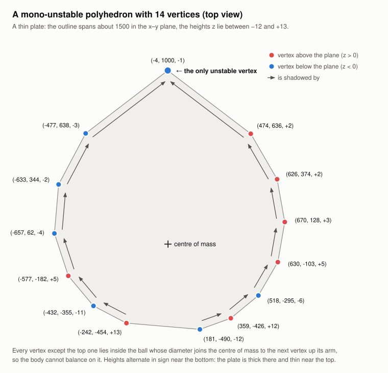

# Monostatic polyhedra: new bounds for the Conway–Guy problems

A homogeneous convex polyhedron is **mono-stable** if it can rest on exactly one face, and
**mono-unstable** if it can balance on exactly one vertex. How small can such polyhedra be? This question
goes back to Conway and Guy (1966/69), and every case of it is still open.

| quantity | before | now (this repository) |
|---|---|---|
| fewest faces of a mono-stable polyhedron | 5 ≤ F ≤ 14 | **6 ≤ F ≤ 14** |
| fewest vertices of a mono-unstable polyhedron | 7 ≤ V ≤ 18 | **9 ≤ V ≤ 14** |

* **Theorem A.** Every homogeneous convex pentahedron has at least two stable faces. This answers a
  question of Goldberg and Guy (1969) and is, to our knowledge, the first improvement of the lower bound in
  Conway and Guy's original problem since 1969. The proof is a rigorous ball-arithmetic cover of the
  three-dimensional space of affine shapes, with 375 rolling patterns and 1,339,090 certificates.
* **Theorem B.** Every homogeneous convex polyhedron with at most 8 vertices has at least two unstable
  vertices. The proof uses exact integer certificates for all 458,394 combinatorial cases.
* **Theorem C.** There is a homogeneous mono-unstable polyhedron with 14 vertices and integer coordinates
  of absolute value at most 1000 (`examples/V14_integer.json`). It is verified in exact arithmetic, and
  the verification fits on one page.



**Manuscript:** [`paper/paper.md`](paper/paper.md) is self-contained: statements, all hand-proved
reductions, the verification protocol and references. Experiments and side results are in
[`paper/supplement.md`](paper/supplement.md). For reviewers, [`REVIEW_GUIDE.md`](REVIEW_GUIDE.md) lists
every step that connects the geometry to the computer checks.

**Status.** These are computer-assisted results produced in an AI-assisted research session (Claude,
Anthropic, with the repository owner). They have **not been peer reviewed**. An independent AI audit of
Theorem A ([`audit/REPORT.md`](audit/REPORT.md)) re-checked every certificate with separate exact code and
found no error. We did not find a 13-vertex mono-unstable or a 13-face mono-stable polyhedron (the
searches were limited, so no conclusion can be drawn). The exact minima remain unknown.

## Verify

```bash
python -m venv venv-verify                                    # CPython 3.11 tested
venv-verify/bin/python -m pip install -r requirements-verify.txt   # Windows: venv-verify\Scripts\python
venv-verify/bin/python reproduce.py            # everything, ~6 min on 16 threads
venv-verify/bin/python reproduce.py --quick    # Theorem C, Theorem B for V <= 7, sphere lists: seconds
```

`reproduce.py` first checks the SHA-256 hashes of the certificate files and of the trusted code
(`CHECKSUMS.sha256`). It then runs each verifier as a separate process and writes a transcript to
`reproduce.log`. A run from a fresh clone in a fresh virtual environment is recorded in
[`reproduce_clean_run.log`](reproduce_clean_run.log).

The individual verifiers are:

```bash
python examples/V14_short_check.py                        # Theorem C (standard library, ~100 lines)
python verify/exact_verify.py examples/V14_integer.json   # Theorem C, full exact classification
python lb_joint/verify_joint.py 8 lb_joint/certs_V8.jsonl.gz lb_joint/exp1_V8_certG.jsonl.gz   # Theorem B, V = 8
python lb_joint/enumerate_spheres.py 8 lb_joint/certs_V8.jsonl.gz   # the sphere list is complete
python lb_joint/flip_closure.py 8 lb_joint/certs_V8.jsonl.gz        # ... and again via Wagner's flip theorem
python -O penta/verify.py                                  # Theorem A (needs sympy, python-flint)
```

Theorems B and C need only the Python standard library. Theorem A needs `sympy` and `python-flint`, with
the versions pinned in `requirements-verify.txt`. The generators and searches need more packages
(`requirements-search.txt`), but they are not needed to check the proofs.

## Layout

| path | content |
|---|---|
| `paper/` | manuscript and supplement |
| `examples/` | the 14-vertex polyhedron of Theorem C, its short check, its exact report |
| `penta/` | Theorem A: chart derivation (`shapes.py`), rigorous kernel (`core.py`), verifier (`verify.py`); untrusted search; Monte-Carlo sanity check |
| `lb_joint/` | Theorem B: standalone verifier, certificates for V = 4…8, sphere-completeness checks; untrusted generators; V = 9 experiments |
| `verify/` | `exact_verify.py`: exact rational classifier of all equilibria of a polyhedron (+ tests; certified 16/18-vertex examples) |
| `audit/` | independent referee pass on Theorem A |
| `search_vertices/`, `search_faces/` | searches for small monostatic polyhedra; certified 14/15-vertex and 14/15-face bodies; Reshetov's bodies re-verified |
| `lowerbound/` | replication of the SDP method of Bozóki–Domokos–Papp–Regős and where it stops |
| `explore/` | exploratory scripts |
