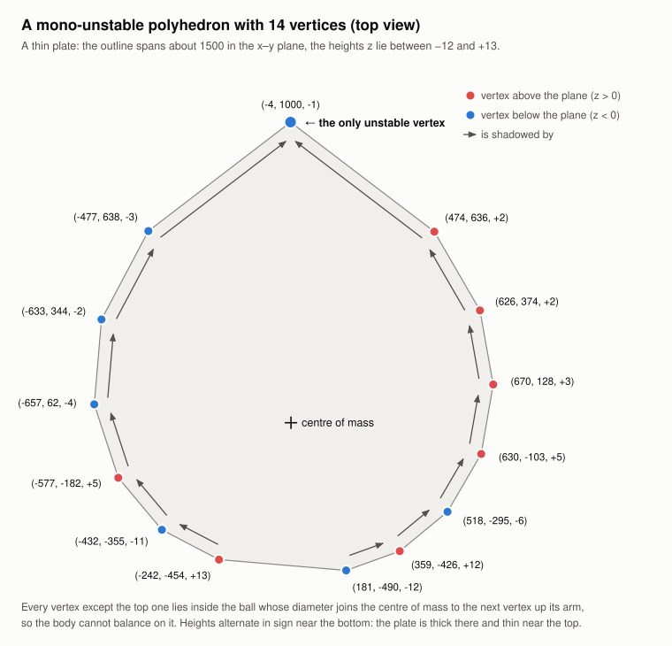

# New bounds for monostatic polyhedra

*Computer-assisted results on the Conway–Guy problems — research notes, November 2026.*
*Not peer reviewed. Every theorem below is backed by an exact or rigorous-arithmetic verification
script in this repository; the hand-written reductions are given here and, for Theorem 3, in
`penta/README.md`, so that they can be checked.*

## 1. Results

A convex polyhedron $P\subset\mathbb R^3$ of uniform density with centre of mass $c$ can rest on a
horizontal plane in finitely many positions. With respect to $c$,

* a face $F$ is a **stable equilibrium** if the orthogonal projection of $c$ onto the plane of $F$
  lies in the relative interior of $F$;
* a vertex $v$ is an **unstable equilibrium** if the plane through $v$ perpendicular to $v-c$ meets
  $P$ only in $v$.

$P$ is *mono-stable* if it has exactly one stable face, *mono-unstable* if it has exactly one unstable
vertex. Conway and Guy (1966/69) asked for the smallest mono-stable polyhedron; the family of questions
"what is the least number of faces / vertices of a homogeneous monostatic polyhedron" is open in every
case. The state of the art was

| quantity | known bounds | source |
|---|---|---|
| $F_S$ = min. faces, mono-stable | $5\le F_S\le 14$ | Conway–Guy 1969 (no monostable tetrahedron); Reshetov 2014 |
| $V_U$ = min. vertices, mono-unstable | $7\le V_U\le 18$ | Bozóki–Domokos–Papp–Regős 2024; Domokos et al. 2020 |

**Theorem 1 (lower bound for vertices).** Every homogeneous convex polyhedron with at most 8 vertices
has at least two unstable vertices. Hence $V_U\ge 9$.

**Theorem 2 (upper bound for vertices).** The convex hull of the 14 points

    (  -4, 1000,  -1)  (-477,  638,  -3)  (-633,  344,  -2)  (-657,   62,  -4)  (-577, -182,   5)
    (-432, -355, -11)  (-242, -454,  13)  ( 181, -490, -12)  ( 359, -426,  12)  ( 518, -295,  -6)
    ( 630, -103,   5)  ( 670,  128,   3)  ( 626,  374,   2)  ( 474,  636,   2)

is a homogeneous mono-unstable polyhedron (14 vertices, 24 triangular faces; 2 stable faces, 1 saddle,
1 unstable vertex, the first one). Hence $V_U\le 14$.

**Theorem 3 (lower bound for faces).** Every homogeneous convex polyhedron with five faces has at least
two stable faces. Hence $F_S\ge 6$.

So now

$$9\le V_U\le 14,\qquad 6\le F_S\le 14 .$$

Theorem 3 is, to our knowledge, the first improvement of the lower bound in Conway and Guy's original
problem since 1969. Theorem 1 settles the case $V=7$ left open in [BDPR24] (where non-existence was
conjectured) and also the case $V=8$. Theorem 2 lowers the best known example from 18 to 14 vertices.

Secondary results: a transparent 16-vertex family ("flat pyramids", §4.2); exactly certified mono-stable
polyhedra with 14 and 15 faces with larger safety margins than Reshetov's published integer bodies (§6.2);
an exact polarity between Reshetov's 14-face body and our 14-vertex bodies (§6.1); numerical evidence
that 14 is optimal for thin plates (§4.4). We did **not** find a mono-unstable polyhedron with 13
vertices or a mono-stable one with 13 faces; those searches were limited and prove nothing.

## 2. Preliminaries

Throughout, the origin is at the centre of mass $c$ unless said otherwise.

**Lemma 2.1 (shadowing, [BDPR24]).** Let $r_1,\dots,r_V$ be the vertices of $P$ (origin at $c$).
A vertex $r_i$ is *not* unstable iff some vertex **adjacent** to it satisfies
$(r_j-r_i)\cdot r_i\ge 0$ ("$j$ shadows $i$"). If $j$ shadows $i$ then $|r_j|>|r_i|$.

*Proof.* If $r_i$ is not unstable, the closed half-space $H=\{x:(x-r_i)\cdot r_i\ge0\}$ contains a point
$x\ne r_i$ of $P$. Since $P\subset r_i+\mathrm{cone}\{r_j-r_i: j\sim i\}$, $x-r_i=\sum a_j(r_j-r_i)$ with
$a_j\ge 0$ not all zero, so $(r_j-r_i)\cdot r_i\ge 0$ for some neighbour $j$. Conversely such a $j$ lies in
$H\cap P$. Finally $0<|r_j-r_i|^2=|r_j|^2-|r_i|^2-2(r_j-r_i)\cdot r_i\le |r_j|^2-|r_i|^2$. $\square$

Geometrically, $j$ shadows $i$ iff $r_i$ lies in the closed ball with diameter $[c,r_j]$ (Thales).
Consequently, if $v$ is the only unstable vertex, choosing for each $i\ne v$ a shadowing neighbour
$p(i)$ defines a spanning tree of the graph of $P$ rooted at $v$, along which $|r|$ increases.

**Lemma 2.2 (polarity).** Let $0\in\operatorname{int}P$, $P=\{x:\ell_i\cdot x\le 1\}$, and let
$P^\circ=\operatorname{conv}\{\ell_i\}$ be the polar. The foot of the perpendicular from $0$ onto the
plane of the $i$-th face is $\ell_i/|\ell_i|^2$, and it lies in the relative interior of that face iff
$\ell_j\cdot\ell_i<|\ell_i|^2$ for all $j\ne i$, i.e. iff $\ell_i$ is an unstable vertex of $P^\circ$
*with respect to the origin*. $\square$

So stable faces of $P$ w.r.t. $c$ correspond to unstable vertices of $P^\circ$ w.r.t. $c$ — but $c$ is
in general not the centre of mass of $P^\circ$; this is why the face problem and the vertex problem are
different problems.

## 3. Lower bound for vertices: Gram-matrix certificates (Theorem 1)

Let $P$ have $V$ vertices, exactly one of them, $v$, unstable. Triangulate the faces of $P$ (no new
vertices): the boundary becomes a simplicial 2-sphere $G$ on $V$ vertices, and by Lemma 2.1 there is a
spanning tree $p$ of $G$ rooted at $v$ with

$$\langle S_{i\to p(i)},R\rangle\le 0\quad(i\ne v),\qquad S_{i\to j}=E_{ii}-\tfrac12(E_{ij}+E_{ji}),$$

where $R=(r_a\cdot r_b)_{a,b}$ is the Gram matrix of the vertices: $R\succeq0$, $R\ne0$.

**Centroid identity.** For any vertex $q$, the tetrahedra $T=\operatorname{conv}(q,F)$, $F$ a triangle
of $G$ not containing $q$, tile $P$ (some may be flat). Hence, writing $1_T\in\{0,1\}^V$ for the
indicator of the four vertices of $T$,

$$\sum_{T}\operatorname{vol}(T)\sum_{k\in T}r_k=4\operatorname{vol}(P)\,c=0 .\tag{3.1}$$

[BDPR24] use only the component of (3.1) along $r_v$ (for $q=v$); the resulting relaxation is
genuinely feasible for 1 426 of the 139 636 (tree, tetrahedron) systems with $V=7$, which is why that
method stops at $V\ge7$ (we reproduced this: `lowerbound/`).

**Proposition 3.1 (single-cone certificate).** Fix $(G,v,p)$. Suppose there are $\mu\in\mathbb R^V$ and,
for every tetrahedron $T$ of the cone decomposition from $v$, numbers $y^T_i\ge0$ $(i\ne v)$ such that

$$M_T=\sum_{i\ne v}y^T_i\,S_{i\to p(i)}+\tfrac12\big(\mu 1_T^{\mathsf T}+1_T\mu^{\mathsf T}\big)\succ0\qquad\text{for all }T.$$

Then no polyhedron realises $(G,v,p)$.

*Proof.* Put $w=\sum_k\mu_kr_k$. Dotting (3.1) with $w$ gives $\sum_T\operatorname{vol}(T)\,\mu^{\mathsf T}R1_T=0$,
so some $T^*$ of positive volume has $\langle\frac12(\mu1_{T^*}^{\mathsf T}+1_{T^*}\mu^{\mathsf T}),R\rangle\le0$.
With the shadow inequalities, $\langle M_{T^*},R\rangle\le0$, contradicting $M_{T^*}\succ0$, $R\succeq0$,
$R\ne0$. $\square$

The point is that the direction $w$ in which the centroid identity is tested may depend linearly on the
configuration, and that finding $(\mu,\{y^T\})$ is a *single convex* semidefinite programme per tree
(the method of [BDPR24] is the case $\mu=e_v$).

**Proposition 3.2 (several cones).** Let $Q$ be a set of vertices. Suppose there are symmetric matrices
$W_q$ $(q\in Q)$ with $\sum_qW_q=0$, vectors $\mu^{(q)}$ and multipliers $y^{q,T}\ge0$ such that for every
$q\in Q$ and every tetrahedron $T$ of the cone decomposition from $q$

$$W_q+\sum_{i\ne v}y^{q,T}_iS_{i\to p(i)}+\tfrac12\big(\mu^{(q)}1_T^{\mathsf T}+1_T\mu^{(q)\mathsf T}\big)\succ0 .$$

Then no polyhedron realises $(G,v,p)$.

*Proof.* For each $q$ pick $T_q$ as in the previous proof and add the corresponding matrices: the $W_q$
cancel, the sum is positive definite, and its pairing with $R$ is $\le0$. $\square$

**Computation.** For $V=4,\dots,8$ and every simplicial 2-sphere $G$ on $V$ vertices (1, 1, 2, 5, 14 of
them), every root $v$ up to automorphisms of $G$, and every spanning tree rooted at $v$, an integer
certificate was computed and verified in exact integer arithmetic (Sylvester's criterion by fraction-free
elimination):

| $V$ | spheres | (sphere, root) | trees | certificate |
|---|---|---|---|---|
| 4 | 1 | 1 | 16 | Prop. 3.1 |
| 5 | 1 | 2 | 150 | Prop. 3.1 |
| 6 | 2 | 4 | 1 392 | Prop. 3.1 |
| 7 | 5 | 16 | 24 795 | Prop. 3.1 |
| 8 | 14 | 63 | 432 041 | Prop. 3.1 for 421 834 trees; Prop. 3.2 with $Q=\{v,q\}$ for the other 10 207 |

For $V=8$ the trees not covered by Prop. 3.1 are exactly those in which some triangle avoiding $v$ has
all three vertices at tree-depth $\ge5$ (the analogue of the depth-$\ge4$ obstruction of [BDPR24] for
$V=7$); for them the single-cone Gram relaxation is genuinely feasible, and a second cone removes it.

The verifier `lb_joint/verify_joint.py` (standard library only, integers only) checks: each listed
complex is a simplicial 2-sphere; the listed spheres are pairwise non-isomorphic and their number equals
the known number of triangulations of the sphere with $V$ vertices (OEIS A000109); every vertex is a
listed root or is mapped to one by a listed, verified automorphism; all rooted spanning trees are
enumerated independently (count compared with Kirchhoff's determinant) and each has a certificate; every
certificate matrix is positive definite.

The completeness of the lists of spheres does not have to be taken from the literature:
`lb_joint/enumerate_spheres.py` (standard library only) enumerates *all* labelled simplicial 2-spheres on
$\{0,\dots,V-1\}$ exhaustively (all edge sets with $3V-6$ edges, all exact double covers by triangles)
and compares their number with $\sum_k V!/|\mathrm{Aut}_k|$ over the listed spheres: 1, 10, 195, 5 712 and
223 440 labelled spheres for $V=4,\dots,8$, in agreement in every case. This proves Theorem 1. $\square$

*Outlook: $V=9$.* There are 50 simplicial spheres with 9 vertices and 9 915 284 (sphere, root, tree)
cases. A probe of 1 500 of them (600 random trees, 900 depth-first "long" trees, which are the hard ones)
found every one certifiable by Prop. 3.1 or by Prop. 3.2 with two cones (`explore/probe_V9.log`), so
$V_U\ge10$ is probably provable in the same way with roughly 80 CPU-hours; this has not been done.

## 4. Upper bound for vertices: thin plates (Theorem 2)

### 4.1 The flat-limit principle

Let $x_i(\varepsilon)=(p_i,\varepsilon h_i)$ with $p_i\in\mathbb R^2$, $h_i\in\mathbb R$, and
$P_\varepsilon=\operatorname{conv}\{x_i(\varepsilon)\}$. Since $P_\varepsilon$ is a linear image of $P_1$,
its centroid is $(c',\varepsilon c_h)$ with $c'$ independent of $\varepsilon$: $c'$ is the centroid of the
planar outline $K=\operatorname{conv}\{p_i\}$ weighted by the thickness function of $P_1$ (upper concave
envelope minus lower convex envelope of the heights). And

$$(x_j-x_i)\cdot(x_i-c)=(p_j-p_i)\cdot(p_i-c')+\varepsilon^2(h_j-h_i)(h_i-c_h).$$

So if every vertex but one is *planarly* shadowed with respect to $c'$, then $P_\varepsilon$ is
mono-unstable for all small $\varepsilon>0$. The heights do not enter the shadowing conditions in the
limit; they only shape the mass distribution. This turns the problem into a planar one with a free
"weight function", and it is the mechanism behind all our examples.

In the plane, a *tight Conway spiral* about a point $O$ is a chain $T=P_0,P_1,\dots$ with polar angles
increasing by steps $\varphi_k$ and radii $r_k=r_{k-1}\cos\varphi_k$: then $\angle OP_kP_{k-1}=90^\circ$, so
$P_k$ is on the verge of being shadowed by $P_{k-1}$, and moving the reference point from $O$ by a small
vector $\delta$ with $\delta\cdot(P_{k-1}-P_k)<0$ for all $k$ (roughly: away from $T$) makes all shadowings
strict. Two such arms on either side of $T$ form a convex polygon that is mono-unstable with respect to
every reference point slightly "below" $O$. A homogeneous planar polygon has its centroid *above* $O$
(no homogeneous planar disc is monostatic); the third dimension is used to pull the reference point down.

### 4.2 Flat pyramids: 16 vertices

Take the outline polygon $B$ in a plane and one apex lifted slightly above a point $A'\in B$.
The centroid of the pyramid projects to $(3g+A')/4$, $g$ the centroid of $B$. Choosing $A'$ at the
bottom of the spiral and optimising the spiral angles numerically, this works when the outline has 15
vertices (arms 7+7, 8+6, 9+5 or 10+4); for 14-gons the numerical optimum stays infeasible for every
arm split (a numerical observation, not a proof). This gives certified
mono-unstable polyhedra with 16 vertices (`verify/certificates/seed_V16*`), already below the previous
record 18 — which is itself a flat pyramid over Conway and Guy's 17-gon.

### 4.3 Plates with heights on the outline: 14 vertices

No apex is needed: giving the outline vertices themselves small heights — close to zero at $T$ and on the
upper part of both arms, alternating in sign with growing amplitude along the last 3–4 vertices of each
arm — makes the plate thick near the bottom of the spiral (locally it looks like an antiprism) and
thin near $T$, with no extra vertex. Numerical optimisation (CMA-ES on the planar surrogate, then in
full 3D) finds mono-unstable polyhedra with 14 vertices robustly, for arm sizes 7+6, 8+5 and 9+4.
The example of Theorem 2 is such a plate (arms 7+6) rounded to small integers; a version with a larger
margin is `search_vertices/certified/V14_spiral76_d7.json`.

*Proof of Theorem 2.* `verify/exact_verify.py examples/V14_integer.json` computes, in exact rational
arithmetic, the convex hull (14 vertices, 36 edges, 24 triangles), the volume and the centroid, and
classifies every face, edge and vertex: exactly one vertex is unstable, every other vertex is strictly
shadowed by an adjacent vertex; there are 2 stable faces and 1 saddle edge, no degeneracies, and
$S-H+U=2$. $\square$

### 4.4 Is 14 optimal?

We do not know. Evidence that 14 is optimal *for thin plates*:

* a search for 13 vertices (328 optimisation runs, $3\cdot10^7$ evaluations, all arm splits and many
  height patterns) ended at clean minimax points with all margins equal and negative
  (best angular margin $-7.9\cdot10^{-3}$, against $+1.07\cdot10^{-2}$ at 14);
* in three dimensions the optimiser always drives the thickness to zero: the flat limit is locally optimal;
* an "ideal" bound: for a given outline $K$, the thickness function that pushes the planar centroid
  furthest in a direction is a frustum (plateau below a level, minimal concave extension above it).
  Even with this ideal thickness — which would cost extra vertices — symmetric tight spirals need a
  13-gon (the ideal centroid height is $+0.0285$ for the best 11-gon, $-0.0034$ for the best 13-gon,
  in units where $|T-O|=1$; it must be negative).

None of this is a proof, and genuinely three-dimensional (non-plate) designs were only lightly explored.
The gap $9\le V_U\le14$ remains.

## 5. No mono-stable pentahedron (Theorem 3)

The proof is in `penta/README.md`; in outline:

1. *Affine shape × metric.* With the origin at the centroid, $P=\{x:\ell_i\cdot x\le1\}$. Fix an affine
   normal form of $P$ and let the inner product be arbitrary, $W$ the inverse Gram matrix. Face $i$ is
   not stable iff $\ell_i^{\mathsf T}W(\ell_j-\ell_i)\ge0$ for some adjacent face $j$; this "rolling"
   relation is acyclic, so at most one stable face means a rooted spanning tree $(s,\pi)$ of the
   face-adjacency graph with $\ell_i^{\mathsf T}W(\ell_{\pi(i)}-\ell_i)\ge0$ for all $i\ne s$.
   For fixed shape and tree this is a linear matrix inequality in $W$ (3×3); it is refuted by $y\ge0$
   with $\sum_iy_i\,\mathrm{sym}(\ell_i(\ell_{\pi(i)}-\ell_i)^{\mathsf T})\prec0$.
2. *Shapes.* Pentahedra are triangular frusta/prisms and quadrilateral pyramids; up to affine maps they
   form a 3-parameter family, covered by two charts (a cone frame with toric coordinates, and a prism
   frame near the prisms). The face-adjacency graph has 375 rooted spanning trees.
3. *Rigorous cover.* Each chart is subdivided into boxes; on each box and for each tree an affine
   multiplier $y(x)$ is verified by a mean-value enclosure in ball arithmetic.

The final cover consists of 575 441 certificates on 32 136 boxes in the cone chart and 763 649
certificates on 37 120 boxes in the prism chart (multipliers rounded to 6 significant digits);
`penta/verify.py` re-checks all of them (`penta/verify.log`). An independent audit (`audit/REPORT.md`)
re-verified the certificates with a separate exact-rational implementation and found no error.
Monte-Carlo tests on more than $3\cdot10^6$ random pentahedra (two independent codes, `penta/sanity.log`,
`audit/falsify_random.log`) and optimisation runs found none with fewer than two stable faces. $\square$

The same reduction shows why simplices are easy (all simplices are affinely equivalent, so the question
reduces to one small linear matrix inequality per tree — Conway's and Dawson's theorems) and why the
difficulty grows with the number of faces: the shape space of $F$-hedra has dimension $3F-12$.

## 6. Remarks

### 6.1 Polarity between the two record bodies

Reshetov's 14-face mono-stable polyhedron is a long thin spindle whose 14 faces are all "lateral" and
slightly tilted. By Lemma 2.2 its polar about the centroid is a thin plate with 14 vertices which is
mono-unstable *with respect to the origin*; its own centroid misses the origin by only 0.7 % of the
diameter, and a local optimisation turns it into a genuine mono-unstable polyhedron
(`search_vertices/certified/V14_resh_d6.json`). In the limits "infinitely long spindle" / "infinitely
thin plate" both problems become planar problems about a double spiral, differing only in which point
(centroid of the plate vs. Santaló point of the plate) must lie below the spiral centre.

### 6.2 Faces

Reshetov's four published bodies (14–17 faces, integer plane data) were re-verified exactly; measured
by his safety margin (distance of the centroid projections from the face boundaries divided by
$\mathrm{vol}^{1/3}$) they have margins $1.4\cdot10^{-4}$ (14 faces) and $6.4\cdot10^{-4}$ (15 faces), his
reported best values being $1.2\cdot10^{-3}$ and $4.2\cdot10^{-3}$. Local optimisation reaches
$2.2\cdot10^{-3}$ (14 faces) and $5.5\cdot10^{-3}$ (15 faces) in floating point; the bodies stored in
`search_faces/certified/` are rounded to 4-digit integer plane data, exactly certified mono-stable, with
margins $1.2\cdot10^{-3}$ and $4.6\cdot10^{-3}$. About 100 optimisation runs aimed at 13 faces failed;
this is a small effort compared with Reshetov's $10^{10}$ evaluations and proves nothing.

### 6.3 Simplices

For $d$-simplices the conditions of §5 involve only the Gram matrix of the scaled facet normals, which
has zero row sums; "is there a monostatic $d$-simplex with a given falling pattern" then reduces to one
small semidefinite feasibility problem (which still has to be certified exactly).
All 719 rooted trees on 10 nodes are infeasible, so there is no monostatic 9-simplex — the one case
left open by Dawson, Finbow and Mak. This is not new: it is equivalent to the statement, proved in
[PRDB23, Cor. 6], that mono-unstable 0-skeleta need 11 vertices in every dimension.

### 6.4 Open problems

* Close $9\le V_U\le14$. Is there a mono-unstable polyhedron that is not a thin plate?
* Close $6\le F_S\le14$. The shape × metric method is exact but the shape space of hexahedra is
  6-dimensional; is there a Gram-type relaxation for faces as there is for vertices?
* Prove that thin plates need 14 vertices (a planar variational problem).

## 7. Reproducibility

| claim | command | time |
|---|---|---|
| Theorem 1, $V=7$ | `python lb_joint/verify_joint.py 7 lb_joint/certs_V7.jsonl.gz` | 5 s |
| Theorem 1, $V=8$ | `python lb_joint/verify_joint.py 8 lb_joint/certs_V8.jsonl.gz lb_joint/exp1_V8_certG.jsonl.gz` | 3 min |
| completeness of the sphere lists | `python lb_joint/enumerate_spheres.py 8 lb_joint/certs_V8.jsonl.gz` (same for 4–7) | 1 min |
| Theorem 2 | `python verify/exact_verify.py examples/V14_integer.json` | 1 s |
| Theorem 3 | `python penta/verify.py` | 2 min on 12 cores |

`verify_joint.py` and `exact_verify.py` need only the Python standard library; `penta/verify.py` needs
`sympy` and `python-flint`.

## References

* [CG69] J. H. Conway, R. K. Guy, *Stability of polyhedra*, SIAM Review 11 (1969) 78–82.
* [Daw85] R. Dawson, *Monostatic simplexes*, Amer. Math. Monthly 92 (1985) 541–546; R. Dawson,
  W. Finbow, P. Mak, *Monostatic simplexes II*, Geom. Dedicata 70 (1998); R. Dawson, W. Finbow,
  *Monostatic simplexes III*, Geom. Dedicata 84 (2001).
* [Res14] A. Reshetov, *A unistable polyhedron with 14 faces*, Int. J. Comput. Geom. Appl. 24 (2014) 39–59.
* [DKLRV20] G. Domokos, F. Kovács, Z. Lángi, K. Regős, P. T. Varga, *Balancing polyhedra*,
  Ars Math. Contemp. 19 (2020) 95–124.
* [BDKR22] S. Bozóki, G. Domokos, F. Kovács, K. Regős, *Mono-unstable polyhedra with point masses have
  at least 8 vertices*, Int. J. Solids Struct. 234–235 (2022).
* [PRDB23] D. Papp, K. Regős, G. Domokos, S. Bozóki, *The smallest mono-unstable convex polyhedron with
  point masses has 8 faces and 11 vertices*, Eur. J. Oper. Res. 310 (2023) 511–517.
* [BDPR24] S. Bozóki, G. Domokos, D. Papp, K. Regős, *The smallest mono-unstable, homogeneous convex
  polyhedron has at least 7 vertices*, arXiv:2401.17906.
